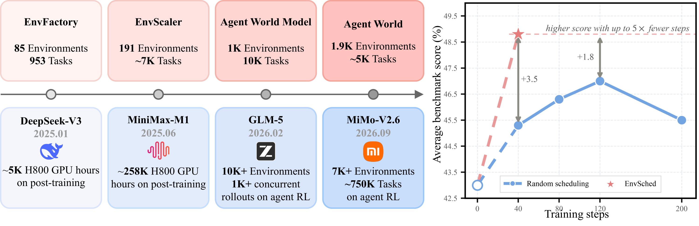
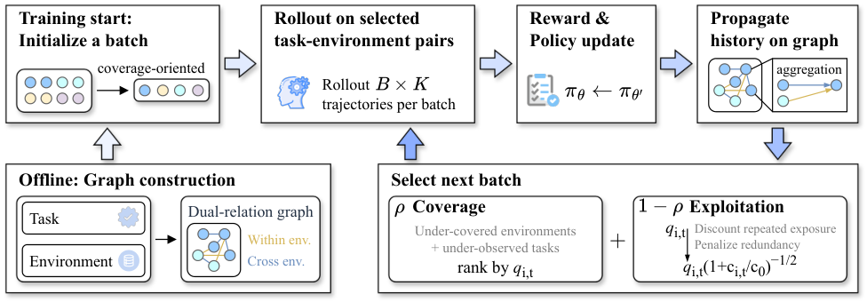
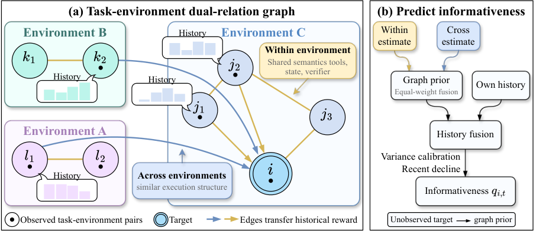

<h1 align="center">EnvSched</h1>
<h3 align="center">Environment-Aware Scheduling for<br>Rollout-Efficient Agent Reinforcement Learning</h3>

<p align="center">
  Sihan Yang<sup>1,*</sup>, Weichen Bai<sup>2,*</sup>, Ruichuan An<sup>1,*,†</sup>, Yiming Cheng<sup>3</sup>, Zhiyuan Feng<sup>3</sup>, Tianyi Jiang<sup>1</sup>,<br>
  Renye Yan<sup>1</sup>, Ning Ding<sup>4</sup>, Yifan Zhang<sup>5,†</sup>, Renrui Zhang<sup>6</sup>, Yehui Tang<sup>4,‡</sup>, Wentao Zhang<sup>1,‡</sup>
</p>

<p align="center">
  <sup>1</sup> PKU · <sup>2</sup> XJTU · <sup>3</sup> THU · <sup>4</sup> Samsung Research · <sup>5</sup> CASIA · <sup>6</sup> CUHK
</p>

<p align="center">
  <sup>*</sup> Equal contribution. &nbsp; <sup>†</sup> Project leader. &nbsp; <sup>‡</sup> Corresponding authors.
</p>

<p align="center">
  <a href="https://arxiv.org/abs/2610.37609"></a>
  <a href="https://arxiv.org/pdf/2610.37609"></a>
  <a href="https://huggingface.co/papers/2610.37609"></a>
  <a href="https://github.com/Hhankyangg/envsched"></a>
  <a href="LICENSE"></a>
</p>

<p align="center">
  <a href="#overview">Overview</a> ·
  <a href="#main-results">Results</a> ·
  <a href="#quick-start">Quick Start</a> ·
  <a href="#repository-layout">Code Structure</a> ·
  <a href="#citation">Citation</a>
</p>

Official implementation of **[EnvSched: Environment-Aware Scheduling for Rollout-Efficient Agent Reinforcement Learning](https://arxiv.org/abs/2610.37609)**.

> **TL;DR:** Schedule informative tasks while preserving environment coverage, using existing rollout history. On Qwen3-8B, EnvSched reaches **48.81** averaged across three benchmarks after **40 steps**, exceeding the best score random scheduling attains during **120 steps** under matched per-step rollout budgets.

<p align="center">
  
</p>

<p align="center"><em>Scaling executable environments and improving rollout efficiency. Right: Qwen3-8B scores averaged across BFCL-v3, τ-Bench, and ACEBench-Agent.</em></p>

## Overview

As executable environments scale, which environment–task pairs should an agent train on next? **EnvSched** combines predicted within-task reward variance with coverage of underobserved environments and tasks. The scheduler learns from rollout history already collected during training, requiring **no additional pilot rollouts**.

<p align="center">
  
</p>

<p align="center"><em>Rollout outcomes update the graph histories, which guide the next batch of training tasks.</em></p>

- **Environment-aware representation.** A dual-relation graph connects tasks within an environment through concrete semantics, tools, states, and verifiers, and across environments through abstract execution and reward topology.
- **History-based informativeness prediction.** Historical reward statistics propagate through both relations and combine with each task's own history to estimate within-task reward variance under the evolving policy.
- **Coverage and exploitation.** Half of each batch covers underobserved environments and tasks; the other half prioritizes informative tasks. Environment quotas, exposure discounts, and a similarity penalty control concentration and redundancy.

<details>
<summary><strong>A closer look at the dual-relation graph</strong></summary>

<p align="center">
  
</p>

Within-environment edges retain domain-specific tools, state, and verifier information. Cross-environment edges transfer evidence between structurally similar tasks in different domains. An unobserved task relies on the graph prior; its own observations gain weight as its history grows. See [Section 2 of the paper](https://arxiv.org/html/2610.37609v1#S2) for the method and Appendices B–E for the estimator, scheduling rules, configuration, and topology-extraction prompt.

</details>

## Main results

We train Qwen3-Thinking models with GRPO on **2,550 tasks across 51 executable environments** from EnvScaler, starting from the original models without SFT. Each training step uses **64 tasks × 8 rollouts**.

The table reports the benchmark **Overall** scores from [Table 1 of the paper](https://arxiv.org/html/2610.37609v1#S3.T1). Higher is better. EnvSched's 40-step rows use **one fifth of the training steps** of the 200-step baselines.

| Model | Scheduler | Steps | BFCL-v3 Multi-Turn | τ-Bench | ACEBench-Agent |
| :--- | :--- | ---: | ---: | ---: | ---: |
| Qwen3-1.7B | Base model | 0 | 8.99 | 11.11 | 30.67 |
| Qwen3-1.7B | Random | 200 | 10.46 | 15.56 | 28.67 |
| Qwen3-1.7B | EnvSched | 40 | 11.75 | 16.97 | 30.67 |
| Qwen3-1.7B | **EnvSched** | **200** | **12.42** | **17.58** | **31.33** |
| Qwen3-4B | Base model | 0 | 25.38 | 36.36 | 53.33 |
| Qwen3-4B | Random | 200 | 28.83 | 37.78 | 56.00 |
| Qwen3-4B | EnvSched | 40 | 30.17 | 41.01 | 58.00 |
| Qwen3-4B | **EnvSched** | **200** | **31.88** | **41.01** | **58.00** |
| Qwen3-8B | Base model | 0 | 28.88 | 41.41 | 58.67 |
| Qwen3-8B | Random | 200 | 33.88 | 47.27 | 55.33 |
| Qwen3-8B | EnvSched | 40 | 37.71 | 50.71 | 58.00 |
| Qwen3-8B | **EnvSched** | **200** | **37.88** | **50.30** | **58.67** |
| Qwen3-30B-A3B | Base model | 0 | 32.88 | 52.53 | 66.00 |
| Qwen3-30B-A3B | Random | 200 | 33.88 | 51.72 | 68.00 |
| Qwen3-30B-A3B | EnvSched | 40 | 35.00 | 53.54 | 70.00 |
| Qwen3-30B-A3B | **EnvSched** | **200** | **37.79** | **54.75** | **70.67** |

At 200 steps, **Qwen3-30B-A3B** improves over random scheduling by **+3.92 / +3.03 / +2.67** points on BFCL-v3 / τ-Bench / ACEBench-Agent. The [paper](https://arxiv.org/abs/2610.37609) also reports DPS and LEEPS baselines, per-subset scores, ablations, and qualitative case studies.

## Release contents

- The EnvSched scheduler ([`selector/`](selector/))
- GRPO training profiles for **Qwen3-1.7B, 4B, and 8B** on the EnvScaler pool ([`configs/`](configs/))
- A modified [ROLL](https://github.com/alibaba/ROLL) runtime with curriculum updates, trajectory logging, and the EnvScaler environments ([`vendor/ROLL/`](vendor/ROLL/))
- An LLM-based task-topology extraction tool ([`topology_generator/`](topology_generator/))

## Quick start

### 1. Install

```bash
git clone https://github.com/Hhankyangg/envsched.git
cd envsched
```

Training needs Linux x86_64, Python 3.10, NVIDIA GPUs, CUDA 12.4, cuDNN 9, and a C++/CUDA build toolchain. The pinned runtime is PyTorch 2.6.0, vLLM 0.8.4, and Megatron Core 0.16.1.

```bash
python3.10 -m venv .venv
source .venv/bin/activate
bash scripts/install.sh
```

Apex and Transformer Engine compile during installation. If needed, set `TORCH_CUDA_ARCH_LIST`, `NVTE_CUDA_ARCHS`, and `MAX_JOBS` for your machine.

To run only the scheduler, data preparation, and tests, a CPU environment is enough:

```bash
python -m pip install -r requirements-selector.txt 'pytest>=8,<10'
python -m pytest -q
```

### 2. Download the training data

```bash
python scripts/prepare_data.py
```

This downloads three files from a pinned EnvScaler commit, checks each against the SHA-256 in `data/manifest.json`, and places them where the training code expects them:

| File | Contents | Installed under |
| --- | --- | --- |
| `envscaler_rl_scenario_metadata.json` | 2,550 RL tasks | `vendor/ROLL/roll/pipeline/agentic/env/envscaler_env/data/` |
| `environment_metadata.json` | The 51 environments those tasks use, taken from EnvScaler's `191_env_metadata.json` | same as above |
| `data_multi_turn_base.json` | BFCL-v3 multi-turn base, used for validation during training | `vendor/ROLL/roll/pipeline/agentic/env/bfcl_env/data/` |

For offline data preparation, pass `--source-dir /path/to/EnvScaler` with a repository clone or a folder holding the three files.

### 3. Generate the task topologies

The cross-environment edges use `data/task_topologies.jsonl`, with one LLM-extracted topology per task. Use an OpenAI-compatible chat endpoint with the prompt in Appendix E of the paper. Extraction makes 2,550 requests; completed tasks are cached so interrupted runs can resume.

```bash
python -m pip install -r topology_generator/requirements.txt
export OPENAI_API_KEY=...                         # your key
export OPENAI_BASE_URL=https://your-endpoint/v1   # only for non-OpenAI endpoints

DATA=vendor/ROLL/roll/pipeline/agentic/env/envscaler_env/data
python topology_generator/generate_topology.py \
  --scenarios $DATA/envscaler_rl_scenario_metadata.json \
  --env-metadata $DATA/environment_metadata.json \
  --model your-model-id \
  --output-dir outputs/topology
cp outputs/topology/task_topologies.jsonl data/
```

See [`topology_generator/README.md`](topology_generator/README.md) for extraction options and resume behavior.

### 4. Prepare training

```bash
python scripts/prepare_data.py --check
python train.py --model-size 1.7b --run-dir runs/prepare --prepare-only
```

`--check` verifies the three data files and confirms the topologies cover exactly the 2,550 tasks. `--prepare-only` resolves the training config and picks the step-0 batch, without needing a GPU or model weights.

### 5. Train

```bash
export LD_LIBRARY_PATH="$VIRTUAL_ENV/lib/python3.10/site-packages/nvidia/cudnn/lib:$VIRTUAL_ENV/lib/python3.10/site-packages/nvidia/cublas/lib:${LD_LIBRARY_PATH:-}"
python train.py --model-size 1.7b --model-path /path/to/Qwen3-1.7B --run-dir runs/qwen3-1.7b
```

| Option | Meaning |
| --- | --- |
| `--model-size` | `1.7b`, `4b`, or `8b`. Pipeline parallelism is 1 for 1.7B and 2 for 4B/8B, so 4B/8B need an even number of GPUs. |
| `--model-path` | Local directory of the original Qwen3 thinking model |
| `--run-dir` | Output directory. Use a new one for each run. |
| `--gpus` | GPU IDs to use; default `0,1,2,3,4,5,6,7` |
| `--max-steps` | Training iterations; default 201 (steps 0–200) |
| `--selector-python` | Python interpreter for the scheduler, if it lives in a separate CPU environment; default is the current one |

All three model sizes share one recipe: 64 tasks × 8 rollouts per step, synchronous rollout, learning rate `1e-6`, policy and advantage clip `0.2`, and no KL penalty. BFCL validation runs every step. Checkpoints are saved every 20 steps and at the last step.

## Where the outputs go

Inside `--run-dir`:

| Path | Contents |
| --- | --- |
| `selector/task_manifest.step_N.json` | The tasks picked for step N, with the reasons for each pick |
| `selector/input_audit.step_N.json` | What the scheduler read when picking step N |
| `output/cases/` | Rollout records, which the scheduler reads to pick the next step |
| `output/logs/` | Training logs |
| `checkpoint/` | Model checkpoints |
| `resolved_config.yaml` | Resolved training config |

During training, ROLL runs `scripts/update_online_variance_curriculum.sh` after each step, and that script runs `selector/select_online_high_variance.py` to pick the next batch.

## Scheduler parameters

The defaults follow Appendix D of the paper. They are the same for every model size.

| Paper | Value | Where it is set |
| --- | --- | --- |
| Batch size B | 64 | `--batch-size` |
| Coverage share ρ | 0.5 (32 of 64 tasks) | `--least-observed-per-batch 32` |
| Exposure scale c₀ | 16 | `--exact-task-exposure-scale` |
| Similarity penalty λ_sim | 0.08 | `--diversity-penalty` |
| Per-step environment cap C₁ | 4 | `--max-per-environment` |
| Three-step environment cap C₃ | 11 | `--environment-window-steps 3 --max-per-environment-window 11` |
| Consecutive-selection cap C_task | 2 | `--max-consecutive-selections` |
| Recent-decline half-life h_short and weight η | 2, 0.5 | `--recency-guard-half-life`, `--recency-guard-strength` |
| Within- and cross-environment neighbors | 6, 12 | `--within-env-neighbors`, `--neighbors` |
| History half-life h_long | 8 | `--half-life-steps` |
| Graph and own-history shrinkage λ_g, λ_s | 2, 2 | `--graph-shrinkage`, `--own-history-shrinkage` |

`scripts/update_online_variance_curriculum.sh` passes the coverage, exposure, quota, penalty, and recent-decline values; the rest are defaults in `selector/select_online_high_variance.py`.

### Faster graph backend (optional)

For large task pools, add `--graph-execution-mode incremental_exact` to `curriculum_update_command` in `configs/selector.yaml`. This backend stores sparse features and per-task neighbor lists, and computes similarities only for newly observed tasks at each step.

## Repository layout

| Path | Purpose |
| --- | --- |
| `selector/select_static_cold_start.py` | Picks the step-0 batch |
| `selector/select_online_high_variance.py` | Builds the graph, predicts variance, and picks each later batch |
| `selector/task_progress_retirement.py` | Progress filter |
| `selector/online_rewarded_id_hack_guard.py`, `selector/id_hack_replay.py` | Identifier filter, with replay of saved actions |
| `selector/reward_statistics.py`, `selector/task_features.py` | Reads rollout rewards; extracts static task and verifier features |
| `selector/incremental_similarity_graph.py` | Optional faster graph backend |
| `topology_generator/` | Generates the task topologies with an LLM |
| `train.py`, `configs/` | Training entry point and the three model profiles |
| `scripts/` | Installation, data download, and the per-step scheduler call |
| `vendor/ROLL/` | Modified ROLL runtime with the EnvScaler and BFCL environments |
| `python_patches/` | Compatibility patches for the training stack |
| `data/` | Data manifest and fixed sampling seeds; downloaded and generated data also go here |
| `tests/` | CPU tests |

## Citation

If you find EnvSched useful in your research, please cite our paper:

```bibtex
@misc{yang2026envschedenvironmentawareschedulingrolloutefficient,
      title={EnvSched: Environment-Aware Scheduling for Rollout-Efficient Agent Reinforcement Learning}, 
      author={Sihan Yang and Weichen Bai and Ruichuan An and Yiming Cheng and Zhiyuan Feng and Tianyi Jiang and Renye Yan and Ning Ding and Yifan Zhang and Renrui Zhang and Yehui Tang and Wentao Zhang},
      year={2026},
      eprint={2610.37609},
      archivePrefix={arXiv},
      primaryClass={cs.LG},
      url={https://arxiv.org/abs/2610.37609}, 
}
```

## Acknowledgments

This project builds on [ROLL](https://github.com/alibaba/ROLL) and the [EnvScaler](https://github.com/RUC-NLPIR/EnvScaler) environment pool. We thank their authors and the developers of the open-source models, benchmarks, and libraries used in this work. See [third-party notices](THIRD_PARTY_NOTICES.md) for attribution and licensing details.

## License

This project is released under the [MIT License](LICENSE). The bundled ROLL runtime uses [Apache-2.0](vendor/ROLL/LICENSE). See [third-party notices](THIRD_PARTY_NOTICES.md) for data and dependency licenses.
